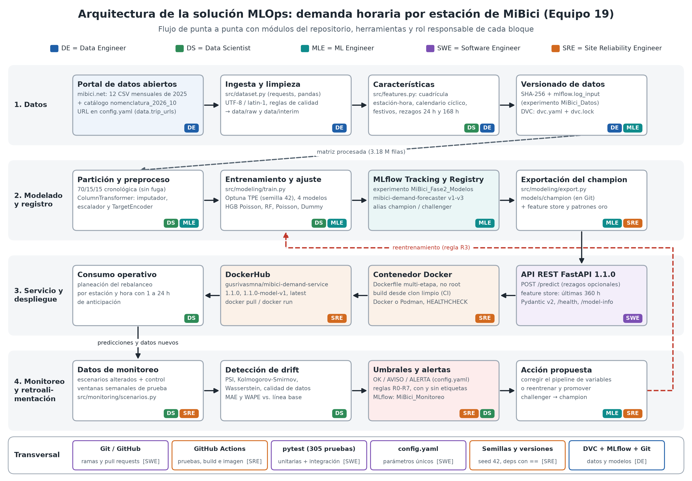

# Sistema MLOps: predicción de demanda horaria por estación en MiBici Guadalajara (Equipo 19)

Proyecto de la materia Operaciones de aprendizaje automático (TC5061), Maestría en Inteligencia Artificial
Aplicada, Tecnológico de Monterrey. Integra las Fases 1, 2 y final: datos versionados, experimentos trazables,
modelo registrado, pruebas automatizadas, API REST, contenedor publicado y monitoreo de data drift.

- Repositorio: https://github.com/AntonioVazquezMartinez/Operacion-de-aprendizaje-automatico---Proyecto-Bici
- Imagen Docker: https://hub.docker.com/r/gusrivasmna/mibici-demand-service (servicio **1.1.0**)
- Modelo en producción: **`models:/mibici-demand-forecaster/1`** (alias `champion`), versionado en Git en `models/champion/`
- Reporte final: `reports/Entrega_Final_Equipo19.docx` (generado con `python reports/build_report.py --readme`)

| Integrante | Matrícula | Rol |
|---|---|---|
| José Antonio Vázquez Martínez | A01797208 | Data Engineer y ML Engineer |
| Jesús Ángel Rincón Ruiz | A01793960 | Data Scientist |
| Erick Francisco Siller Ojeda | A01382929 | Software Engineer |
| Gustavo Alejandro Vázquez Rivas | A01611559 | Site Reliability Engineer (SRE) |

Roles, actividades por fase y matriz RACI: `reports/roles_mlops.md`. Análisis de cada integrante en la fase final:
`reports/fase_final/<nombre>.md`.

## Caso de negocio

Las estaciones de MiBici se vacían o se saturan en las horas pico (8:00 y 18:00) y el rebalanceo con camionetas
es reactivo. El modelo estima las **extracciones de bicicletas por estación y hora** (`demand_count`) con 1 a 24
horas de anticipación para programar la redistribución antes del desabasto. Planteamiento completo en
`reports/ML_Canvas_MiBici.md`.



---

## Integración de las dos soluciones del equipo

Dos integrantes resolvieron la fase final en paralelo y sin haberlo coordinado: Jesús Rincón en la rama
`entrega-final` (PR #5) y Gustavo Vázquez en `fase-final`. Comparamos las dos requisito por requisito, ejecutamos
las pruebas de ambas y las fusionamos en `fase-final` (merge `14e4886`, que conserva los commits de las dos ramas);
las piezas de `entrega-final` se adaptaron al código de `fase-final` con sus propias pruebas.

| Aspecto | `fase-final` (Gustavo) | `entrega-final` (Jesús) | Solución integrada |
|---|---|---|---|
| Rezagos en `/predict` | El cliente envía los tres rezagos | Feature store de las últimas 360 h; rezagos opcionales con `lags_source` | Feature store y rezagos opcionales (servicio 1.1.0) |
| Modelo en la imagen | Fuera de Git (DVC); build con el modelo exportado localmente | Modelo dentro de Git | Modelo en Git: `docker build` funciona en un clon limpio |
| Contenedor | Docker, `python:3.13.9-slim` por digest, `gusrivasmna/mibici-demand-service` | Podman, Python 3.12, `angrinconr/mibici-demand-api` | Imagen de `fase-final` y comandos de Podman en `docs/docker.md` |
| CI | Pruebas con cobertura y verificación de la imagen publicada | Pruebas y construcción de la imagen desde el repo | Ambos: job `docker` en `tests.yml` y `docker-reproducibilidad.yml` |
| Pruebas | Unitarias e integración con cobertura por módulo | Incluye la coherencia servicio-pipeline | Suite de `fase-final` + prueba de coherencia (`tests/test_serving_feature_store.py`) |
| Reproducibilidad | 500 predicciones en varios entornos; reentrenamiento en Linux | 1,000 predicciones en Windows, Linux y Podman | Ambas + binario original de la Fase 2 (`models/fase2_original/`) |
| Monitoreo | 8 escenarios, PSI/KS/Wasserstein, calidad de datos, MAE y WAPE | Escenarios simulados y monitoreo semanal con PSI/KS | Monitoreo de `fase-final` |
| Auditoría de predicciones | — | `PREDICTION_LOG` (JSONL) | Registro opcional de predicciones |

---

## Requisitos de la entrega final y dónde está la evidencia

| Requisito | Evidencia |
|---|---|
| 1. Pruebas unitarias y de integración con pytest, comando único | `pytest -q` → 305 aprobadas, cobertura 94 % (`reports/fase_final/logs/10_pytest_cobertura.log`); `tests/README.md`; sección [Pruebas](#pruebas) |
| 2. API con FastAPI, `POST /predict`, validación Pydantic, esquema documentado | `src/serving/`, `docs/api.md`, `docs/openapi.json`, `docs/postman_collection.json`, capturas 12-14; sección [API](#api-de-predicción) |
| 2. Ruta y versión del artefacto del modelo en el README | Sección [Artefacto del modelo](#artefacto-del-modelo): `models:/mibici-demand-forecaster/1` |
| 3. Dependencias fijadas, semillas, entorno limpio, comparación con referencia | `requirements*.txt` (`==`), `config.yaml` (`seed: 42`), `reports/fase_final/comparacion_fase2.md`, `reports/fase_final/reproducibilidad/` (incluye clon limpio y binario de la Fase 2); sección [Reproducibilidad](#reproducibilidad) |
| 3. Artefactos versionados (DVC / MLflow / Git) | `dvc.yaml`, `dvc.lock`, `docs/dvc.md`, MLflow Model Registry, `models/` en Git; sección [Versionado](#versionado-de-datos-y-modelos) |
| 4. Dockerfile, `docker build` / `docker run`, DockerHub con tags | `Dockerfile`, `docs/docker.md`, `reports/fase_final/reproducibilidad/dockerhub_tags.json`; sección [Docker](#docker) |
| 5. Data drift: datos alterados, métricas vs. línea base, gráficos, umbrales, alertas y acción | `src/monitoring/`, `reports/drift/drift_report.md`, figuras 07-10; sección [Data drift](#data-drift) |

---

## Estructura del proyecto (Cookiecutter Data Science v2)

```text
├── .github/workflows/
│   ├── tests.yml                    <- job tests: pytest + cobertura (Python 3.13); job docker: construye la imagen
│   │                                   desde el repo, la levanta y la verifica
│   └── docker-reproducibilidad.yml  <- hadolint y verificación de la imagen publicada en DockerHub
├── Dockerfile, .dockerignore, docker-compose.yml   <- Imagen del servicio (FastAPI + modelo champion + feature store)
├── docker/                <- Imagen y scripts para reentrenar el pipeline completo en Linux (comparación de entornos)
├── Makefile               <- make test, make serve, make drift, make docker-build, make report, ...
├── config.yaml            <- Configuración única: rutas, URL, reglas, semilla, modelos, serving, monitoreo
├── dvc.yaml, dvc.lock     <- Pipeline de DVC (data → features → train → export → drift) y huellas
├── pyproject.toml         <- Paquete, configuración de pytest y cobertura
├── requirements.txt       <- Dependencias con versión exacta (entrenamiento, pruebas, DVC, reporte)
├── requirements-serve.txt <- Dependencias mínimas del servicio (imagen Docker)
├── requirements-lock.txt  <- pip freeze completo del entorno de entrenamiento
├── environment.yml        <- Entorno Conda (alternativo)
│
├── data/                  <- raw/ (CSV del portal), interim/ (viajes limpios), processed/ (matriz estación-hora); no van a Git
├── docs/                  <- api.md, openapi.json, postman_collection.json, docker.md, dvc.md
├── models/                <- En Git
│   ├── champion/          <- Modelo MLflow exportado: model.pkl, MLmodel, stations.csv, feature_store.csv.gz
│   ├── champion_metadata.json                <- Versión, URI, SHA-256 (modelo, estaciones, feature store), métricas
│   ├── reference_predictions.csv             <- 500 predicciones de referencia con rezagos (patrón oro)
│   ├── reference_feature_store_predictions.csv <- 200 predicciones de referencia sin rezagos (feature store)
│   └── fase2_original/    <- Binario original de la Fase 2 (rama entrega-final); no entra a la imagen
├── notebooks/1.0-eq19-eda-mibici.ipynb
├── references/diccionario_datos.md
├── reports/
│   ├── build_report.py, report_data.py, docx_helpers.py   <- Generador del reporte final en Word
│   ├── Entrega_Final_Equipo19.docx, Fase 1_Equipo19.*, Fase2_Equipo19.docx
│   ├── drift/             <- drift_report.md / .json, drift_summary.csv
│   ├── fase2/, fase_final/ <- Archivos por integrante, comparación con Fase 2, logs y reproducibilidad (v1.0.0/ = historial)
│   ├── figures/           <- 00/00b arquitectura y ciclo MLOps, 01-05 EDA, 06 modelos, 07-10 drift, 11 GitHub,
│   │                         12-16 capturas (Swagger, esquema, respuesta, DockerHub, GitHub Actions)
│   ├── ML_Canvas_MiBici.md, roles_mlops.md, declaracion_ia.md, model_comparison.csv
├── scripts/               <- api_smoke.py, verify_reproducibility.py, compare_fase2_binary.py, export_openapi.py,
│                             build_api_response_figure.py, build_architecture_diagram.py, docker_smoke.*
├── src/
│   ├── config.py          <- config.yaml, rutas y semillas globales (set_global_seeds)
│   ├── dataset.py         <- Descarga y limpieza
│   ├── features.py        <- Cuadrícula estación-hora, calendario, rezagos, partición, preprocesador
│   ├── plots.py           <- Figuras del EDA y de evaluación
│   ├── tracking.py        <- MLflow, SHA-256 y versionado de datos
│   ├── modeling/          <- pipeline.py, train.py (Optuna + Registry), predict.py, export.py
│   ├── serving/           <- app.py (FastAPI), schemas.py (Pydantic v2), feature_store.py (rezagos en línea)
│   └── monitoring/        <- scenarios, metrics, rules, figures, report y drift (CLI)
└── tests/
    ├── unit/              <- Pruebas unitarias por módulo
    ├── integration/       <- Flujo de punta a punta, exportación, artefactos versionados y binario de la Fase 2
    └── test_serving.py, test_serving_feature_store.py, test_drift.py, conftest.py
```

---

## Inicio rápido

```bash
git clone https://github.com/AntonioVazquezMartinez/Operacion-de-aprendizaje-automatico---Proyecto-Bici.git
cd Operacion-de-aprendizaje-automatico---Proyecto-Bici
python -m venv .venv
# Windows PowerShell: .venv\Scripts\Activate.ps1   |   Linux / macOS: source .venv/bin/activate
pip install -r requirements.txt
pip install -e .
pytest -q                      # 305 pruebas (no requieren datos ni la base de MLflow)
```

Solo para usar el servicio, sin instalar nada de Python: ver [Docker](#docker).

## Pipeline completo

```bash
python -m src.dataset            # descarga (URL de config.yaml) + limpieza     -> data/raw, data/interim
python -m src.features           # características y rezagos                    -> data/processed
python -m src.plots              # figuras del EDA                              -> reports/figures
python -m src.modeling.train     # Optuna + MLflow Tracking + Model Registry
python -m src.modeling.predict   # predicción del periodo de prueba con @champion
python -m src.modeling.export    # models/champion (+ feature store) + metadatos + patrones oro
python -m src.monitoring.drift   # simulación de data drift                      -> reports/drift
```

Equivalentes: `make pipeline` o `dvc repro`. Todos los módulos aceptan `--config otra_config.yaml`.

**Datos.** `src/dataset.py` descarga automáticamente los 12 CSV mensuales de 2025 y el catálogo
`nomenclatura_2026_10.csv` con las URL de `config.yaml` (`data.trip_urls`, `data.stations_url`); el portal exige
un User-Agent de navegador, que el código envía. Si un CSV ya está en `data/raw/` se usa directamente. La lectura
tolera UTF-8 o latin-1 y valida el encabezado. El catálogo de la Fase 2 (`nomenclatura_2026_09.csv`) ya no está
publicado, y el portal republicó los CSV de 2025: hoy se leen 4,532,032 viajes contra 4,520,095 en la Fase 2, y
julio ya se lee con el lector estándar (detalle en `reports/fase_final/comparacion_fase2.md`).

**MLflow UI:** `mlflow ui --backend-store-uri sqlite:///mlruns.db --port 5000` (experimentos `MiBici_Datos`,
`MiBici_Fase2_Modelos`, `MiBici_Monitoreo`; pestaña Models: `mibici-demand-forecaster`).

---

## Pruebas

```bash
pytest -q                                          # comando único: unitarias + integración
pytest -q -m "not integration"                     # solo unitarias (rápidas)
pytest -q -m integration                           # solo integración (datos → entrenamiento → Registry → predicción)
pytest -q --cov=src --cov-report=term-missing      # con cobertura (lo que corre CI)
```

Resultado de la fase final (`reports/fase_final/logs/10_pytest_cobertura.log`): **305 aprobadas, 0 fallidas,
cobertura 94 % de `src/`** (líneas y ramas). Las pruebas usan datos sintéticos y una base de MLflow temporal: no
necesitan red, datos reales ni `mlruns.db`. `tests/test_serving_feature_store.py` comprueba que el servicio calcula
los mismos rezagos y predicciones que el pipeline (sin *training-serving skew*). Las pruebas que comparan contra
los patrones oro usan tolerancia `1e-9` (ver [Reproducibilidad](#reproducibilidad)); con ella la suite completa
también pasa en un contenedor Linux con el modelo real
(`reports/fase_final/reproducibilidad/pipeline_linux_pytest_v2.log`; la primera corrida, con igualdad exacta, dio
268/2 y está en `pipeline_linux_pytest.log` como antecedente). Detalle en `tests/README.md`.

**CI** ([pestaña Actions](https://github.com/AntonioVazquezMartinez/Operacion-de-aprendizaje-automatico---Proyecto-Bici/actions)): `tests.yml` corre la suite con cobertura en cada push y, en un segundo
job (`docker`), construye la imagen desde el repositorio, la levanta y la verifica contra los patrones oro; como el
modelo está en Git, ahí corren también las pruebas que lo usan. Corrida del push final:
[45066506318](https://github.com/AntonioVazquezMartinez/Operacion-de-aprendizaje-automatico---Proyecto-Bici/actions/runs/45066506318).

---

## API de predicción

```bash
uvicorn src.serving.app:app --host 0.0.0.0 --port 8000     # o: make serve
```

| Método | Ruta | Descripción |
|---|---|---|
| GET | `/health` | Estado: modelo cargado y SHA-256 verificado (200 / 503) |
| GET | `/model-info` | Nombre, versión, URI, alias, run_id, hiperparámetros, métricas, columnas, versiones y feature store |
| POST | `/predict` | Lote de 1 a 1,000 instancias con estación y fecha-hora; los tres rezagos son **opcionales** (sin ellos los calcula el feature store) |
| POST | `/predict/raw` | Filas con las 13 columnas del modelo (verificación de reproducibilidad) |

Ejemplos reales del servicio 1.1.0 (de `docs/api.md` y `reports/fase_final/logs/20_api_smoke.log`):

```bash
# Con los tres rezagos (misma predicción que la versión 1.0.0)
curl -s -X POST http://localhost:8000/predict -H "Content-Type: application/json" \
  -d '{"instances":[{"station_id":24,"datetime":"2025-11-08T10:00:00","demand_lag_24h":5.0,"demand_lag_168h":0.0,"demand_same_hour_mean_7d":3.5714285714285716}]}'
# {"predictions":[{"station_id":24,"datetime":"2025-11-08T10:00:00","demand_pred":2.6064224732591033,"lags_source":"request","demand_lag_24h":5.0,"demand_lag_168h":0.0,"demand_same_hour_mean_7d":3.5714285714285716}],"model":{"name":"mibici-demand-forecaster","version":1,"uri":"models:/mibici-demand-forecaster/1","alias":"champion","algorithm":"hist_gradient_boosting"},"n_instances":1}

# Sin rezagos: el servicio los calcula con el feature store
curl -s -X POST http://localhost:8000/predict -H "Content-Type: application/json" \
  -d '{"instances":[{"station_id":24,"datetime":"2025-12-31T18:00:00"}]}'
# {"predictions":[{"station_id":24,"datetime":"2025-12-31T18:00:00","demand_pred":3.1631559452523517,"lags_source":"feature_store","demand_lag_24h":0.0,"demand_lag_168h":1.0,"demand_same_hour_mean_7d":1.8571428571428572}],"model":{...},"n_instances":1}
```

Sin rezagos solo se pueden predecir las horas de la ventana del feature store (`2025-12-24T00:00:00` a
`2026-01-01T23:00:00`); fuera de ella responde 422 `outside_feature_store_window`. Validación con Pydantic v2: tipos
estrictos, rezagos finitos y ≥ 0 (los tres o ninguno), fecha ISO-8601, sin campos extra; los errores responden 422,
404 (estación desconocida) o 503 (modelo no cargado) con el mismo cuerpo JSON. Registro opcional de predicciones con
`PREDICTION_LOG` (JSONL). Documentación completa: [`docs/api.md`](docs/api.md); esquema OpenAPI:
[`docs/openapi.json`](docs/openapi.json) (también en `/docs`); colección de Postman:
[`docs/postman_collection.json`](docs/postman_collection.json); capturas `reports/figures/12_api_swagger_docs.png`,
`13_api_esquema_predict.png` y `14_api_respuesta_200.png`.

---

## Artefacto del modelo

| Concepto | Valor |
|---|---|
| **Modelo y versión (MLflow Model Registry)** | **`models:/mibici-demand-forecaster/1`** |
| Alias | `champion` (`models:/mibici-demand-forecaster@champion`); `challenger` = v2 (RandomForest) |
| Algoritmo | `HistGradientBoostingRegressor` con pérdida Poisson (scikit-learn 1.9.1) |
| Carpeta que carga la API y la imagen (en Git) | `models/champion/` (modelo MLflow autocontenido + `stations.csv` + `feature_store.csv.gz`) |
| SHA-256 de `models/champion/model.pkl` | `ca4331a49948c99b29580463d89e8aa1dc8d14451f866c029588f3de67ce2ed5` |
| Feature store | 370 estaciones × 360 h (2025-12-17 a 2025-12-31); SHA-256 en `champion_metadata.json` |
| Metadatos | `models/champion_metadata.json` (run_id `9ef2f57d97374770bf956469ba97a02d`, hiperparámetros, SHA-256, métricas, columnas, versiones) |
| Métricas en prueba (8-nov a 31-dic-2025) | MAE 0.7651 · RMSE 1.3018 · R² 0.6937 · devianza Poisson 0.9144 |
| Patrones oro | `models/reference_predictions.csv` (500 filas con rezagos) y `models/reference_feature_store_predictions.csv` (200 filas sin rezagos) |

La carpeta está en Git, así que no hace falta exportarla para usarla. Para regenerarla desde el Registry (requiere
`mlruns.db` de quien entrenó) y verificarla:

```bash
python -m src.modeling.export                 # alias champion -> models/champion + metadatos + patrones oro
python -m src.modeling.export --verify-only   # recarga la carpeta y compara con la referencia
```

La API recalcula el SHA-256 del modelo y del feature store al arrancar y no carga un modelo distinto al de los
metadatos (responde 503).

---

## Docker

Comandos de la entrega (desde la raíz de un clon, sin pasos previos: el modelo está en Git):

```bash
docker build -t ml-service:latest .
docker run -p 8000:8000 ml-service:latest
```

Imagen publicada (no requiere el repositorio ni los datos):

```bash
docker pull gusrivasmna/mibici-demand-service:1.1.0
docker run -p 8000:8000 gusrivasmna/mibici-demand-service:1.1.0
```

| Tag | Significado | Digest |
|---|---|---|
| `1.1.0` | Servicio 1.1.0: rezagos opcionales con feature store, `PREDICTION_LOG` | `sha256:00747b9667e5a7f0b160185624920332b4452e16bcc672770c399a5910f3efe2` |
| `1.1.0-model-v1` | Servicio 1.1.0 con `models:/mibici-demand-forecaster/1` | el mismo de `1.1.0` |
| `latest` | Última imagen publicada (1.1.0) | el mismo de `1.1.0` |
| `1.0.0` | Servicio 1.0.0: `/predict` exige los tres rezagos | `sha256:c28158a1fa7f6f1e6dfe6bf482e00e5ddd60ee882ff4b21942e1bd98bb081fb6` |
| `1.0.0-model-v1` | Servicio 1.0.0 con `models:/mibici-demand-forecaster/1` | el mismo de `1.0.0` |

Tamaño de 1.1.0: 127,182,682 bytes comprimida en DockerHub y 556 MB en disco
(`reports/fase_final/reproducibilidad/dockerhub_tags.json`, `docs/docker.md`). Imagen multi-etapa sobre
`python:3.13.9-slim` fijada por digest, usuario sin privilegios y `HEALTHCHECK`. Con Podman los comandos son los
mismos (`podman build --format docker -t ml-service:latest .`; ver `docs/docker.md`, adaptado de la rama
`entrega-final`). Detalle, política de tags, publicación y capturas (`reports/figures/15_dockerhub_tags.png`,
`16_github_actions.png`): [`docs/docker.md`](docs/docker.md).

---

## Reproducibilidad

- **Dependencias fijadas:** `requirements.txt` y `requirements-serve.txt` con `==`; `requirements-lock.txt` con el
  entorno completo; imagen base fijada por digest.
- **Semillas:** `seed: 42` en `config.yaml`, inyectada en los estimadores, el `TargetEncoder`, Optuna (TPE) y en
  `set_global_seeds` (random, NumPy, `PYTHONHASHSEED`). Optuna corre sin corte por tiempo
  (`tuning.timeout_seconds: null`) para que el número de trials no dependa de la máquina.
- **Entorno limpio vs. Fase 2:** reentrenamiento completo en un venv nuevo; MAE de prueba 0.7651 contra 0.7656 de
  la Fase 2 (−0.06 %), mismos hiperparámetros y misma asignación de alias
  (`reports/fase_final/comparacion_fase2.md`).
- **Mismo artefacto en otros entornos:** `scripts/verify_reproducibility.py --url <servicio>` envía las 500 filas
  con rezagos (por `/predict` y `/predict/raw`) y las 200 sin rezagos, y compara fila por fila (tolerancia `1e-9`).

| Entorno (servicio 1.1.0) | Dif. máx. con rezagos | Idénticas (500) | Sin rezagos: dif. máx. (idénticas/200) | Veredicto | Evidencia |
|---|---:|---:|---:|---|---|
| Windows 11, venv de entrenamiento | 0.0 | 500/500 | 0.0 (200/200) | PASS | `reports/fase_final/reproducibilidad/windows_venv.json` |
| Contenedor Linux local (`ml-service:latest`) | 8.88e-16 | 495/500 | 0.0 (200/200) | PASS | `reproducibilidad/contenedor_local.json` |
| Clon limpio (solo archivos de Git), contenedor Linux | 8.88e-16 | 495/500 | 0.0 (200/200) | PASS | `reproducibilidad/clon_limpio.json` |
| Imagen descargada de DockerHub (`docker pull`) | 8.88e-16 | 495/500 | 0.0 (200/200) | PASS | `reproducibilidad/imagen_dockerhub.json` |
| GitHub Actions, imagen construida desde el repo | 8.88e-16 | 495/500 | 0 (200/200) | PASS | `reproducibilidad/github_actions_build.json`, [corrida 45066506318](https://github.com/AntonioVazquezMartinez/Operacion-de-aprendizaje-automatico---Proyecto-Bici/actions/runs/45066506318) |
| GitHub Actions, imagen publicada | 8.88e-16 | 495/500 | 0 (200/200) | PASS | `reproducibilidad/github_actions.json`, [corrida 45066506421](https://github.com/AntonioVazquezMartinez/Operacion-de-aprendizaje-automatico---Proyecto-Bici/actions/runs/45066506421) |

La diferencia de 1 ulp en Linux está en el `exp()` final de la pérdida Poisson, que calcula la biblioteca
matemática del sistema (UCRT en Windows, glibc en Linux); la suma de los árboles es idéntica bit a bit
(`reproducibilidad/diagnostico_exp/resumen.txt`). El historial de la versión 1.0.0 (incluida su verificación en
GitHub Actions) está en `reproducibilidad/v1.0.0/`.

- **Binario de la Fase 2:** `models/fase2_original/` es el modelo de la Fase 2 (entrenado en otra máquina con Python
  3.12, conservado en la rama `entrega-final`). Reproduce sus 1,000 predicciones de referencia con diferencia 0.0
  en Windows y 8.9e-16 en Linux; frente al champion reentrenado tiene los mismos hiperparámetros y predicciones
  casi iguales (correlación 0.9989), pero no es el mismo binario porque los datos del portal cambiaron
  (`reproducibilidad/fase2_binario_vs_reentrenado.md`).
- **Reentrenar en Linux:** da DummyRegressor y RandomForest idénticos bit a bit, pero el boosting elige otros
  hiperparámetros (diferencia máxima de métricas 9.5e-4) por el mismo redondeo: lo reproducible entre sistemas
  operativos es el binario versionado y la conclusión del experimento, no el reentrenamiento bit a bit
  (`reports/fase_final/reproducibilidad/pipeline_linux_vs_windows.md`).

---

## Data drift

```bash
python -m src.monitoring.drift        # o: make drift
```

Referencia de distribución: conjunto de validación; línea base de desempeño: conjunto de prueba (MAE 0.7651,
WAPE 0.6025). Dos familias de escenarios: corrupción de entradas (la demanda real no cambia) y cambio real (se
alteran los viajes y se recalculan variables y objetivo), más un control sin alterar. Resultados
(`reports/drift/drift_summary.csv`):

| Escenario | Familia | MAE | ΔMAE | ΔWAPE | Nivel | Nivel sin etiquetas | Acción (regla) |
|---|---|---:|---:|---:|---|---|---|
| control | Control | 0.7651 | +0.0 % | +0.0 % | OK | OK | `R0_ok` |
| rezagos_faltantes | Corrupción | 0.8222 | +7.5 % | +7.5 % | ALERTA | ALERTA | `R1_pipeline` |
| rezagos_escala | Corrupción | 0.8843 | +15.6 % | +15.6 % | ALERTA | ALERTA | `R1_pipeline` |
| reloj_desfasado | Corrupción | 1.0499 | +37.2 % | +37.2 % | ALERTA | ALERTA | `R1_pipeline` |
| aumento_demanda | Cambio real | 1.1113 | +45.2 % | +3.7 % | ALERTA | AVISO | `R3_reentrenar` |
| caida_demanda | Cambio real | 0.6611 | −13.6 % | +43.8 % | ALERTA | ALERTA | `R3_reentrenar` |
| vacaciones_diciembre | Cambio real | 0.7190 | −6.0 % | +33.7 % | ALERTA | AVISO | `R3_reentrenar` |
| estaciones_nuevas | Cambio real | 0.7892 | +3.1 % | +3.1 % | ALERTA | ALERTA | `R2_catalogo` |

En las ventanas semanales del conjunto de prueba (sin alterar), el nivel pasa de OK a ALERTA a partir del
20-dic-2025 (WAPE +38.8 %): drift real por vacaciones. El MAE por sí solo no basta: baja cuando baja la demanda,
por eso se vigila también el WAPE.

**Umbrales** (`config.yaml` → `monitoring.thresholds`, aviso / alerta): PSI 0.10 / 0.25; estadístico D de KS
0.10 / 0.20; Wasserstein normalizada 0.10 / 0.25; faltantes, rezagos fuera de dominio y estaciones no vistas
1 % / 5 %; desfase del perfil horario 1 h / 2 h; degradación de MAE y WAPE +10 % / +25 %.
**Acciones:** R1 revisar el pipeline antes de reentrenar; R2 actualizar el catálogo; R3 reentrenar, evaluar el
challenger y mover el alias si mejora; R6/R7 vigilar o preparar un challenger cuando aún no hay etiquetas.
Reporte completo: [`reports/drift/drift_report.md`](reports/drift/drift_report.md); figuras
`reports/figures/07_drift_distribuciones.png` a `10_drift_ventanas_tiempo.png`.

---

## Versionado de datos y modelos

- **MLflow Tracking:** cada versión de datos (raw, interim, processed) con su SHA-256 y `mlflow.log_input`; cada
  corrida con parámetros, métricas y figuras.
- **MLflow Model Registry:** `mibici-demand-forecaster` v1 (`champion`), v2 (`challenger`), v3.
- **Git:** el modelo exportado (`models/champion/`, unos 6.6 MB con el feature store), sus metadatos y los patrones
  oro; así el servicio se reconstruye desde un clon limpio.
- **DVC:** `dvc.yaml` con cinco etapas (`data → features → train → export → drift`) que dependen del código, los
  datos y las secciones de `config.yaml`; `dvc.lock` guarda la huella MD5 de cada dependencia y salida (incluidos
  los 12 CSV crudos y la carpeta del modelo). Las salidas de `export` van con `cache: false` porque ya están en Git.
  Sin remoto externo: los datos son públicos y se descargan con `dvc repro`. Ver [`docs/dvc.md`](docs/dvc.md).

```bash
dvc status    # ¿los artefactos locales corresponden a dvc.lock?
dvc dag       # grafo de etapas
dvc repro     # ejecuta solo las etapas afectadas por un cambio
```

---

## Resultados del modelo

| Modelo | MAE val. | MAE prueba | RMSE prueba | R² prueba | Registry |
|---|---:|---:|---:|---:|---|
| HistGradientBoosting (Poisson) | 0.8042 | **0.7651** | 1.3018 | 0.6937 | v1 · `champion` |
| RandomForest | 0.8255 | 0.7836 | 1.3510 | 0.6702 | v2 · `challenger` |
| PoissonRegressor | 1.2512 | 1.0983 | 3.1102 | −0.7481 | v3 |
| Dummy (media) | 1.6316 | 1.5374 | 2.3552 | −0.0024 | no se registra |

Fuente: `reports/model_comparison.csv`. Partición cronológica 70/15/15; el champion se elige por MAE de
validación, se reentrena con train + val y se evalúa una sola vez en prueba.

## Decisiones de modelado

| Decisión | Justificación |
|---|---|
| Rezagos de 24 h y 168 h y media de la misma hora en 7 días (se eliminó el de 1 h) | El horizonte es de 1 a 24 h: el rezago de 1 h no estaría disponible (fuga de información) |
| Partición cronológica 70/15/15; test usado una sola vez | Evita usar el futuro para predecir el pasado y el sesgo optimista |
| Pérdida de Poisson | Conteos no negativos con muchos ceros (53 % de las combinaciones estación-hora) |
| HistGradientBoosting como champion | Captura interacciones estación × hora; la regresión de Poisson lineal produce predicciones extremas (R² negativo) |
| TargetEncoder para la estación | 370 estaciones sin cientos de columnas one-hot |
| Sin PCA | En la Fase 1 empeoró el RMSE y con 13 variables no aporta |
| Desplegar el binario verificado (SHA-256), no reentrenar en cada entorno | El reentrenamiento entre sistemas operativos no es idéntico bit a bit |
| Rezagos opcionales con feature store (servicio 1.1.0) | El cliente no reimplementa el cálculo; el servicio usa la misma función del entrenamiento |
| Modelo exportado en Git | `docker build` funciona en un clon limpio y en el CI sin pasos previos |

---

## Reporte final

```bash
python scripts/build_architecture_diagram.py   # figuras 00 y 00b (arquitectura y ciclo MLOps)
python reports/build_report.py --readme        # reports/Entrega_Final_Equipo19.docx y filas de GitHub Actions del README (o: make report)
```

El generador lee todas las cifras de los artefactos (CSV, JSON, logs, `git log`) y marca en amarillo lo pendiente.
Las reflexiones individuales se toman de `reports/fase_final/<nombre>.md`.

## Declaración de uso de Inteligencia Artificial

Ver `reports/declaracion_ia.md`. Resumen: se usó Anthropic. (2026). Claude [Modelo de lenguaje grande] (Opus 5.5 en
las Fases 1 y 2; Fable 5.2 y Opus 5.5 en la fase final) como apoyo en la redacción, la estructura del repositorio,
el código, la comparación e integración de las dos ramas de la fase final y la documentación. El equipo revisó,
ejecutó y validó el código; los resultados corresponden a ejecuciones reales registradas en los logs y artefactos
del repositorio. https://claude.ai/
